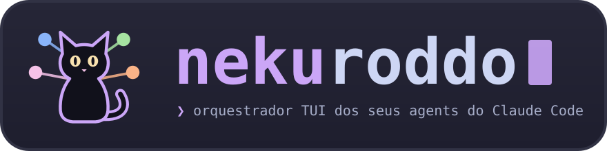

<p align="center"></p>

<p align="center">
  <a href="https://github.com/aqilputi/nekuroddo/actions/workflows/ci.yml"></a>
  <a href="go.mod"></a>
  <a href="https://goreportcard.com/report/github.com/aqilputi/nekuroddo"></a>
  <a href="LICENSE"></a>
</p>

<p align="center"><b>Um painel de terminal para as suas sessões do Claude Code: quem está rodando, quem está te esperando e quanto cada uma gastou.</b></p>

> **English.** nekuroddo is a terminal UI (Go + Charm) that orchestrates your
> [Claude Code](https://claude.com/claude-code) sessions. It lists every session by project context, shows
> which ones are waiting on you, embeds the real `claude attach` in a side pane, tracks cost and plan usage,
> and lets related sessions warn each other through agent groups. It wraps the installed `claude` CLI instead
> of reimplementing it, so new Claude Code releases just work. Docs are in Portuguese (pt-BR).

## Por que

Quem roda de 1 a 6 sessões do Claude Code ao mesmo tempo passa o dia trocando de aba para descobrir quem
terminou, quem parou numa pergunta e quem está pedindo permissão. A espera vira o gargalo: em 30 dias de uso
real, uma sessão parada esperando resposta ficou assim por 2,8 min na mediana e 54 min no p90.

O nekuroddo junta tudo numa tela só e te leva direto a quem precisa de você. Ele **embrulha o `claude`
instalado em vez de reimplementá-lo**: a lista vem de `claude agents --json`, as sessões novas saem de
`claude --bg` e o painel da direita roda `claude attach <id>` de verdade num terminal virtual. Toda
atualização do Claude Code chega sem mudança aqui. Um gatinho preto (`ᓚᘏᗢ`) dorme no canto e mia quando um
agent volta.

## Recursos

- **Árvore por contexto:** contexto (regex sobre o `cwd`) → sessão → subagents, com estado, modelo e a fatia
  de uso de cada nó.
- **Inbox:** quem está te esperando, por urgência (bloqueada > voltou > ociosa no prompt), com a pergunta, as
  opções e a resposta sugerida. `r` responde sem sair da lista.
- **Claude Code embutido:** a sessão abre num painel (2/3 da tela) ou em tela cheia, com mouse, rolagem e
  clipboard. É o `claude attach` real, num PTY.
- **Eventos em tempo real:** com o hook `nk hook`, a tela reage em menos de 1 s; sem ele, o polling de 2 s
  continua valendo.
- **Custo e uso:** barras da janela de 5 h e da semana (`claude -p /usage`), fatia de cada sessão, custo
  estimado por modelo e orçamento diário.
- **Grupos de agents ✉:** sessões que fazem trabalho parecido se avisam quando uma acha um problema que vale
  para as outras.
- **Todos + Jira:** a lista da skill `todo`, com agent disparado no repo certo, e issues do Jira sem guardar
  token (via `claude -p` + conector Atlassian).
- **Teclado de vim**, paleta de comandos fuzzy (`:`), filtro (`/`), 5 temas com escolha claro/escuro
  automática, arquivar, renomear e mover sessões entre contextos.

```text
 ᓚᘏᗢ nekuroddo   ● 3 rodando  ◆ 1 te esperando  ✓ 2 voltaram   5h ██████░░░░░░ 47% ↻3h  semana 22%       catppuccin-mocha
 1 Sessões   2 Inbox (1)   3 Todos (4)   4 Arquivo (2)    ativas ≤3d · ordem: atividade
╭─ sessões ──────────────────────────────────────╮╭─ deploy rc 2 · ✳ conferindo o probe ─────────────────────────────────╮
│ ▾ infra (4)                                41% ││ > <cross-session-message from-name="deploy rc 1">                    │
│ ┃│ ◐ deploy rc 1 ✉→ #deploy-rc  ██▍  18%    1m ││   [#deploy-rc] readiness probe quebra no chart 4.2                   │
│▌▍│ ◆ deploy rc 2 ✉← #deploy-rc  █▏    7%    4m ││   O chart trocou /healthz por /ready. No rc 1 corrigi                │
│ ┃│ ◐ deploy rc 3 ✉← #deploy-rc  █▌   11% agora ││   com readinessProbe.path: /ready no values.yaml.                    │
│  │ ✓ migra schema ✓1            ▋     4%   12m ││                                                                      │
│  │   └ ● revisa a migration          haiku-4-5 ││ ● Vou conferir se o mesmo vale para este deploy.                     │
│ ▾ dev · nekuroddo (2)                       9% ││ ● Read(charts/api/values-rc2.yaml)                                   │
│  │ ✓ docs do release            █     6%    2m ││   ⎿  Read 84 lines                                                   │
│  │ ◐ ◆ refactor de paths        ▍     3%   25m ││ ● Vale: aqui o probe também aponta para /healthz.                    │
│ ▸ pessoal (3)                               2% ││   Troco para /ready e rodo o helm diff de novo?                      │
│                                                ││                                                                      │
│                                                ││ > _                                                                  │
╰────────────────────────────────────────────────╯╰──────────────────────────────────────────────────────────────────────╯
 NORMAL  :group agrupa 1 · esc limpa seleção · enter abre · r responde                    ᓚᘏᗢ ✉ deploy rc 1 → deploy rc 2
```

<sub>Três deploys parecidos no grupo `#deploy-rc` (barra `▍`; `┃` destaca os pares da sessão sob o cursor). O
`deploy rc 1` achou um problema e avisou os outros dois: `✉→` em quem mandou, `✉←` em quem recebeu, e o gato
diz quem falou com quem. À direita, o `claude attach` real do `deploy rc 2` recebendo o aviso. Mais abaixo, uma
sessão selecionada com `space` (`◆`) esperando um `:group`.</sub>

## Instalação

**Requisitos**

- Linux. macOS deve funcionar, mas não foi testado. `notify-send` é opcional.
- Go **1.27.2** ou mais novo (o que o [`go.mod`](go.mod) pede).
- [Claude Code](https://claude.com/claude-code) **2.1+** no `PATH`, com `claude agents`, `claude --bg` e
  `claude attach`.

**Com `go install`**

```sh
go install github.com/aqilputi/nekuroddo/cmd/nekuroddo@latest
ln -sf "$(go env GOPATH)/bin/nekuroddo" ~/.local/bin/nk
```

**A partir do código**

```sh
git clone https://github.com/aqilputi/nekuroddo && cd nekuroddo
make install        # instala ~/.local/bin/nekuroddo e o atalho ~/.local/bin/nk
```

O binário se chama `nekuroddo`; o comando do dia a dia é `nk`. Variáveis de ambiente e a migração de quem
usava o antigo `neko` estão em [docs/instalacao.md](docs/instalacao.md).

## Uso rápido

```sh
nk
```

1. A aba **Sessões** mostra as sessões vivas e as dos últimos 2 dias, agrupadas por contexto.
2. `a` pula para a próxima sessão que está te esperando; `enter` abre no painel já no modo INSERT.
3. Converse com o claude normalmente; `ctrl+]` devolve o teclado ao nekuroddo.
4. `r` responde rápido sem abrir o painel; `c` dispara uma sessão nova em background.
5. `?` (ou `ctrl+/`) lista todas as teclas, e `:` abre a paleta com qualquer ação.

Para eventos em tempo real e grupos de agents, instale os [hooks](#hooks).

## Teclas

| tecla | ação |
|---|---|
| `j` `k` `gg` `G` `ctrl+d/u` | navega |
| `h` / `l` | fecha / abre nó (contexto → sessão → subagents) |
| `space` | seleciona a sessão e desce, como no yazi; numa linha de contexto, dobra a seção |
| `esc` | limpa a seleção (e, depois, o filtro) |
| `a` / `A` | próxima / anterior sessão te esperando |
| `1` `2` `3` `4` / `tab` | Sessões · Inbox · Todos · Arquivo |
| `enter` / `o` / `O` | abre e foca · abre sem focar · tela cheia |
| `i` / `ctrl+]` | entra / sai do INSERT (as teclas vão para o claude) |
| `ctrl+k` | pula para um chat rodando ou esperando |
| `r` | resposta rápida (vem com a resposta sugerida; um número sozinho escolhe a opção) |
| `c` | nova sessão em background (`tab` troca o modo de permissão) |
| `n` / `m` | renomeia a sessão (no contexto, a seção) / muda a sessão de contexto |
| `X` / `H` / `S` | arquiva · mostra ocultas · ordem (atividade/custo/nome) |
| `x` / `dd` | `claude stop` / `claude rm` (com confirmação) |
| `w` / `z` | fecha o painel / zoom |
| `/` | filtro fuzzy |
| `:` ou `ctrl+p` | paleta: qualquer ação, sessão, tarefa ou tema; aceita `group <tag>`, `ungroup [tag]` e `notify #tag <msg>` |
| `u` · `T` · `R` | uso do plano · tema · atualiza |
| `?` ou `ctrl+/` · `q` | ajuda · sai |

Aba Todos, mouse e detalhes em [docs/teclas.md](docs/teclas.md).

## Grupos de agents

Quando várias sessões fazem a mesma coisa (quatro deploys parecidos, a mesma migração em cinco repos), um
problema que uma descobre costuma valer para as outras. Os grupos fazem essa ponte:

1. **Selecione** as sessões com `space` (elas ganham `◆`) e rode `:group deploy-rc`. Cada membro passa a
   mostrar a barra `▍` e o chip `#deploy-rc` na cor do grupo.
2. **Os membros ficam sabendo dos pares** pelo hook síncrono `nk hook-context` (`SessionStart`,
   `UserPromptSubmit`, `PostToolUse`): na próxima ferramenta, cada sessão recebe a lista dos pares e o
   combinado do grupo.
3. **Uma avisa as outras** com o `SendMessage` entre sessões, nativo do Claude Code. A primeira linha segue o
   formato `[#deploy-rc] o problema em uma frase`.
4. **O nekuroddo mostra a conversa:** detecta a mensagem pelo hook `UserPromptSubmit` de quem recebe, marca `✉→`
   no remetente e `✉←` nos destinatários (piscando por 90 s, depois apagado por 15 min), o gato mia
   `✉ A → B` e o painel de detalhes da sessão lista as últimas mensagens.
5. **Você também avisa:** `:notify #deploy-rc a janela de deploy mudou para 18h` deixa uma nota que cada membro
   recebe na próxima chamada de ferramenta.

Limites: os pares precisam ser sessões vivas na mesma máquina; uma sessão em outro modo de permissão segura a
mensagem entre sessões até você aprovar; e quem recebe trata o aviso como informação, não como instrução, de
propósito. Guia completo, com o diagrama do fluxo, em [docs/grupos.md](docs/grupos.md).

## Hooks

Opcionais, mas recomendados. Em `~/.claude/settings.json` (ou via `/hooks`):

```json
{
  "hooks": {
    "Notification": [ { "hooks": [ { "type": "command", "command": "~/.local/bin/nk hook", "timeout": 5, "async": true } ] } ],
    "Stop":         [ { "hooks": [ { "type": "command", "command": "~/.local/bin/nk hook", "timeout": 5, "async": true } ] } ],
    "SubagentStop": [ { "hooks": [ { "type": "command", "command": "~/.local/bin/nk hook", "timeout": 5, "async": true } ] } ],
    "SessionEnd":   [ { "hooks": [ { "type": "command", "command": "~/.local/bin/nk hook", "timeout": 5, "async": true } ] } ],
    "SessionStart": [ { "hooks": [
      { "type": "command", "command": "~/.local/bin/nk hook", "timeout": 5, "async": true },
      { "type": "command", "command": "~/.local/bin/nk hook-context", "timeout": 5 }
    ] } ],
    "UserPromptSubmit": [ { "hooks": [
      { "type": "command", "command": "~/.local/bin/nk hook", "timeout": 5, "async": true },
      { "type": "command", "command": "~/.local/bin/nk hook-context", "timeout": 5 }
    ] } ],
    "PostToolUse": [ { "hooks": [
      { "type": "command", "command": "~/.local/bin/nk hook-context", "timeout": 5 }
    ] } ]
  }
}
```

- `nk hook` é **assíncrono**: grava uma linha em `~/.local/state/nekuroddo/events.jsonl`, não imprime nada e
  sempre sai com 0. Nunca bloqueia nem altera a sessão.
- `nk hook-context` é **síncrono** (sem `async`), porque o que ele imprime vira contexto da sessão. Para uma
  sessão fora de grupos, não imprime nada.

Detalhes em [docs/hooks.md](docs/hooks.md).

## Configuração

Tudo é opcional. Copie o [`config.example.toml`](config.example.toml) para `~/.config/nekuroddo/config.toml`
e ajuste contextos (regex sobre o `cwd`), preços por modelo, orçamento diário, tema, modo de permissão
inicial, o mapeamento dos todos e o Jira. Referência campo a campo em
[docs/configuracao.md](docs/configuracao.md).

## Privacidade

O nekuroddo só **lê** arquivos locais do `~/.claude`, nunca abre os arquivos `.key`, não chama a API da
Anthropic e não envia dados a lugar nenhum. As únicas chamadas ao modelo são as que você pede (`/usage` e
Jira), feitas pelo seu próprio `claude`. Os formatos que ele lê são internos ao Claude Code e podem mudar entre
versões; o parsing fica isolado em `internal/claude`, com testes.

## Documentação

A pasta [`docs/`](docs/index.md) é um bundle [OKF 0.2](https://okf.md/spec/):
[instalação](docs/instalacao.md) · [teclas](docs/teclas.md) · [configuração](docs/configuracao.md) ·
[grupos](docs/grupos.md) · [hooks](docs/hooks.md) · [arquitetura](docs/arquitetura.md) ·
[fontes de dados](docs/fontes-de-dados.md) · [painel embutido](docs/painel-embutido.md) ·
[Jira](docs/jira.md) · [requisitos](docs/requisitos.md) · [log](docs/log.md).

Duas notas de projeto que valem a leitura:

- **Por que o painel funciona assim:** é um PTY + o emulador `charmbracelet/x/vt`, copiado célula a célula
  para a tela, com contornos para bugs do `x/vt` v0.1.0 (OSC com bytes não-ASCII, teclas com modificadores).
  Veja [painel-embutido.md](docs/painel-embutido.md).
- **Jira sem token:** leitura e escrita passam por um `claude -p` headless com o conector Atlassian do
  claude.ai e uma única ferramenta liberada por chamada. O nekuroddo confere o resultado cru da ferramenta, não
  o texto do modelo. Veja [jira.md](docs/jira.md).

## Desenvolvimento

```sh
make build        # bin/nekuroddo
make test         # go test -race ./...
make cover        # cobertura em coverage.out (make cover-html gera coverage.html)
make cover-check  # falha abaixo de 80%, o gate do CI
make lint         # golangci-lint (make fmt formata)
make vet
make ci           # vet + lint + cover-check, o mesmo que roda no GitHub Actions
```

```text
cmd/
  nekuroddo/   entrada: nk (TUI; --listen também serve por RPC), nk serve, nk run, nk hook, nk hook-context
  vtprobe/     diagnóstico do painel embutido
internal/
  claude/      fala com o CLI (agents, --bg, stop, rm, /usage) e lê transcripts e estado
  store/       junta CLI e transcripts num Snapshot imutável: sessões, atenção, custo, overrides
  events/      grava e lê events.jsonl (nk hook) e reconhece mensagens entre sessões
  groups/      grupos de agents: groups.json, notas do :notify e o nk hook-context
  term/        PTY + x/vt, filtro de OSC e codificação de teclas
  core/        domínio puro: árvore, inbox, comandos e eventos como dados; sem I/O
  app/         casos de uso, registro de comandos, barramento de eventos, confirmações; só portas
  wire/        raiz de composição: liga claude, store, term, groups… às portas de app
  tui/         a TUI Bubble Tea v2: teclas → comandos de app; árvore, inbox, todos, paleta, painéis
  rpc/         servidor opcional (nk serve, nk --listen): HTTP+SSE+WS sobre Unix socket
  lua/         runtime gopher-lua (init.lua, plugins/, API nk.*)
  archtest/    testes da regra de dependência entre pacotes
  theme/       os 5 temas e a escolha claro/escuro
  cat/         o gatinho ᓚᘏᗢ
  config/      TOML, padrões e a migração dos diretórios do neko
  paths/       diretórios de config, estado e cache
  todo/        lista de tarefas, só pela CLI da skill todo
  jira/        Jira via claude -p + conector Atlassian
```

Arquitetura e fluxo de dados em [docs/arquitetura.md](docs/arquitetura.md).

### Roadmap

Em andamento: separar o domínio da TUI (`internal/tui`) num core headless (`internal/core` + `internal/app`),
servido localmente como opcional; um GUI com gatinhos 3D low-poly que embute os terminais reais do Claude
Code; e scripts de automação em Lua, na TUI e no GUI. Nada disso existe em código ainda — a TUI atual e todos
os atalhos continuam funcionando do mesmo jeito enquanto a refatoração avança. Plano completo em
[docs/plano-arquitetura.md](docs/plano-arquitetura.md).

## Contribuindo

Issues e PRs são bem-vindos. Leia o [CONTRIBUTING.md](CONTRIBUTING.md) antes de abrir um PR e o
[SECURITY.md](SECURITY.md) para reportar vulnerabilidades. As mudanças de cada versão estão no
[CHANGELOG.md](CHANGELOG.md).

## Licença

[MIT](LICENSE)
