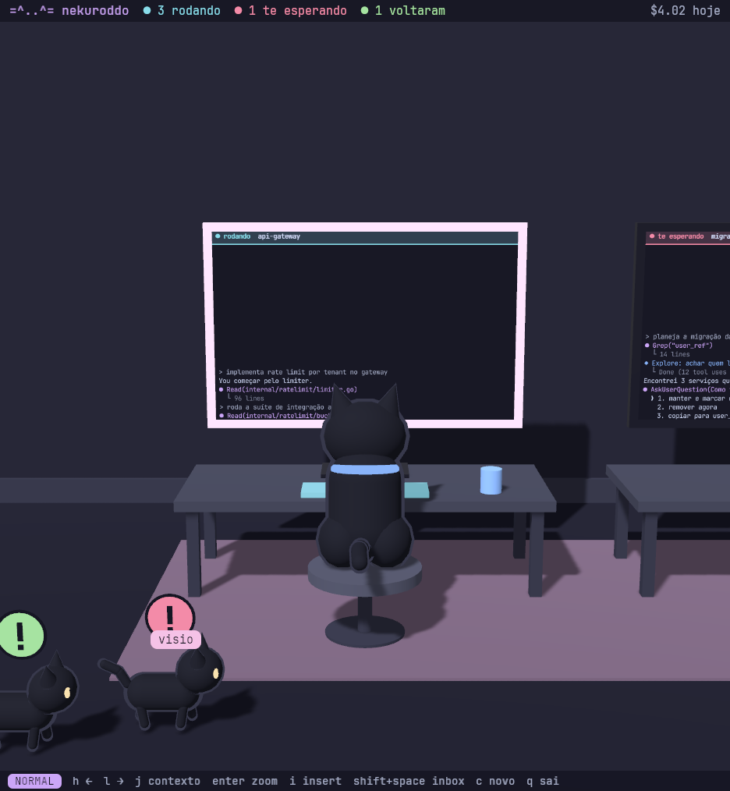

# GUI (`nkg`)

O `nkg` é o companheiro gráfico da TUI: um **escritório** em 3D low-poly. Cada sessão do Claude Code é um
gatinho sentado de costas para você numa mesa, e no monitor dele roda o que a sessão está fazendo agora. É
um app nativo (Rust + [Bevy](https://bevyengine.org)), sem navegador e sem webview.

Nada de domínio mora no GUI: ele é um cliente do mesmo [core](arquitetura.md) pelo mesmo
[protocolo](protocolo.md) (HTTP+JSON, SSE e WebSocket), lê o mesmo registro de comandos e o mesmo
`/v1/keymap` que a TUI. Um comando ou uma tecla que você adiciona em [Lua](lua.md) aparece nos dois clientes.



## Como rodar

```sh
make install          # nk (o core) — o nkg sobe o `nk serve` sozinho
make install-gui      # compila o nkg (release) e instala ~/.local/bin/nkg + atalho no lançador
nkg                   # suas sessões de verdade
nkg --demo            # o mundo de demonstração (nada é real)
```

Para compilar é preciso o Rust e as bibliotecas de sistema do Bevy (alsa, udev, Vulkan, Wayland/X11,
xkbcommon). O link usa clang + lld (`gui/office/.cargo/config.toml`).

| flag | o quê |
|---|---|
| `--demo` | sobe `nk serve --demo` em vez do core real |
| `--connect tcp://127.0.0.1:PORTA` / `unix:///caminho` | usa um core que já está rodando (`nk --listen` ou `nk serve`) em vez de subir um |
| `--nk <binário>` | qual `nk` executar (padrão: o do `PATH`) |
| `--reduced-motion` (ou `NKG_REDUCED_MOTION=1`) | sem animação: câmera corta, gatos param, a inbox não anda |
| `--shot <arquivo.png>` `[--frames N] [--shot-zoom] [--shot-inbox] [--focus N]` | desenha, salva uma screenshot e sai (para verificação) |

Sem `--connect`, o `nkg` sobe o próprio `nk serve --listen tcp://127.0.0.1:0` com um diretório de runtime
privado e o encerra quando sai.

## O escritório

- **Uma coluna por sessão**, numa faixa horizontal no estilo [niri](https://github.com/YaLTeR/niri): você
  anda pela faixa e a câmera desliza; os vizinhos ficam meio à vista. Sessões do mesmo contexto dividem um
  tapete com o nome do contexto, com um espaço maior entre contextos.
- **O gato mostra o estado**: digitando quando a sessão está rodando, de orelha em pé com um `!` quando está
  esperando você, dormindo (`z z`) quando terminou e voltou.
- **O monitor mostra a atividade**: o tail da sessão (`GET /v1/sessions/{id}/tail`, atualizado pelo evento
  `session.tail`) — prompts, ferramentas, respostas. Com um painel de terminal aberto, o monitor mostra a
  tela do terminal ao vivo.
- A barra de cima conta quantas sessões estão rodando, esperando e voltaram, e o custo do dia; a de baixo
  mostra o modo e as teclas.

## Zoom: o terminal

`enter` aproxima a câmera do monitor da coluna em foco e abre o terminal da sessão (o mesmo painel que a TUI
embute, via WebSocket). Quando a câmera chega, o terminal é desenhado nítido por cima do monitor, no tamanho
de célula real da janela.

- `i` entra no **INSERT**: as teclas vão para o terminal (com a mesma codificação xterm da TUI);
  `ctrl+]` volta ao NORMAL; `ctrl+shift+v` cola.
- `esc` sai do zoom (o painel continua vivo); `w` fecha o painel.

## A inbox: os gatos que andam

Quando uma sessão precisa de você (ficou esperando, terminou, ou recebeu uma mensagem de outra), um gato em
3D entra andando pelo corredor na frente das mesas com um ícone em cima (`!` esperando, `!` verde voltou,
envelope para mensagem) e para em frente à mesa da sessão. No máximo cinco andam ao mesmo tempo; o resto vira
um contador "+N na inbox".

`shift+space` (comando `inbox.summon` do core) ou um clique no gato leva você direto à sessão, já em zoom.

## Teclado

As teclas vêm do keymap do core (as mesmas da TUI e as que você definiu em Lua); sem core, valem estas:

| tecla | o quê |
|---|---|
| `h` / `l` (ou `←` / `→`) | coluna anterior / próxima |
| `j` | próximo contexto |
| `enter` | zoom no monitor (abre o terminal) |
| `i` | INSERT (no zoom) |
| `ctrl+]` | volta ao NORMAL |
| `esc` | sai do zoom |
| `w` | fecha o painel |
| `shift+space` | inbox: vai para quem está chamando |
| `c` | nova sessão |
| `q` | sai |

Confirmações do core (parar uma sessão, por exemplo) aparecem como uma pergunta na barra de baixo: `y`/`n`.

## Desempenho

O `nkg` é reativo: só desenha quando algo muda (um evento do core, uma tecla, uma animação em curso). Com
`--reduced-motion`, ou quando nenhum gato está ativo, fica praticamente parado; os gatos ativos animam numa
taxa reduzida. Os monitores fora do zoom são texturas pequenas redesenhadas só quando o tail muda.

## Desenvolvimento

```sh
make office-test      # cargo test --workspace (nk-client + nkg)
make office-lint      # rustfmt + clippy -D warnings
make run-office       # nkg --demo
```

- `gui/office/crates/nk-client`: o cliente do protocolo (sem tokio): HTTP, SSE com `Last-Event-ID`,
  WebSocket dos painéis, emulação de terminal (alacritty_terminal) e codificação de teclas. Os testes de
  integração rodam contra um `nk serve --demo` de verdade.
- `gui/office/crates/nkg`: o app Bevy. A lógica (faixa, câmera, navegação, fila da inbox, poses, teclado,
  rasterização dos monitores) fica em módulos puros com testes; `app.rs` só liga isso aos sistemas do Bevy.
- `nkg --demo --shot x.png [--shot-zoom | --shot-inbox]` é o jeito de ver uma mudança sem abrir a janela na
  mão.

## Solução de problemas

- **"nk: não encontrado"**: instale o core (`make install`) ou passe `--nk /caminho/do/nk`.
- **Janela preta / erro de adaptador**: o Bevy precisa de Vulkan (ou GL) funcionando; confira `vulkaninfo`.
- **O monitor está vazio**: sessões sem transcript ainda não têm tail; ele aparece na primeira atividade.

## Ver também

- [gui-web.md](gui-web.md) — o GUI anterior, em navegador (legado: `make install-gui-web`)
- [protocolo.md](protocolo.md), [arquitetura.md](arquitetura.md), [lua.md](lua.md)
